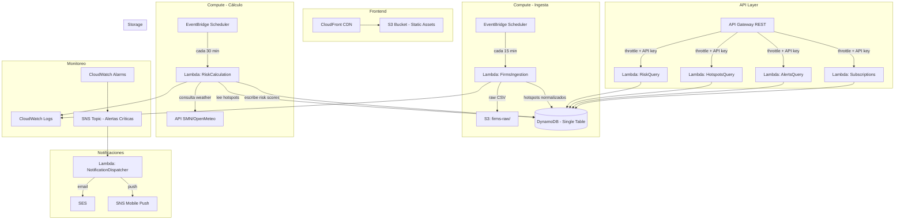
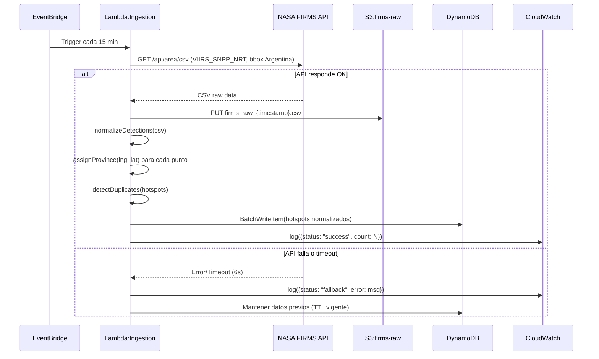
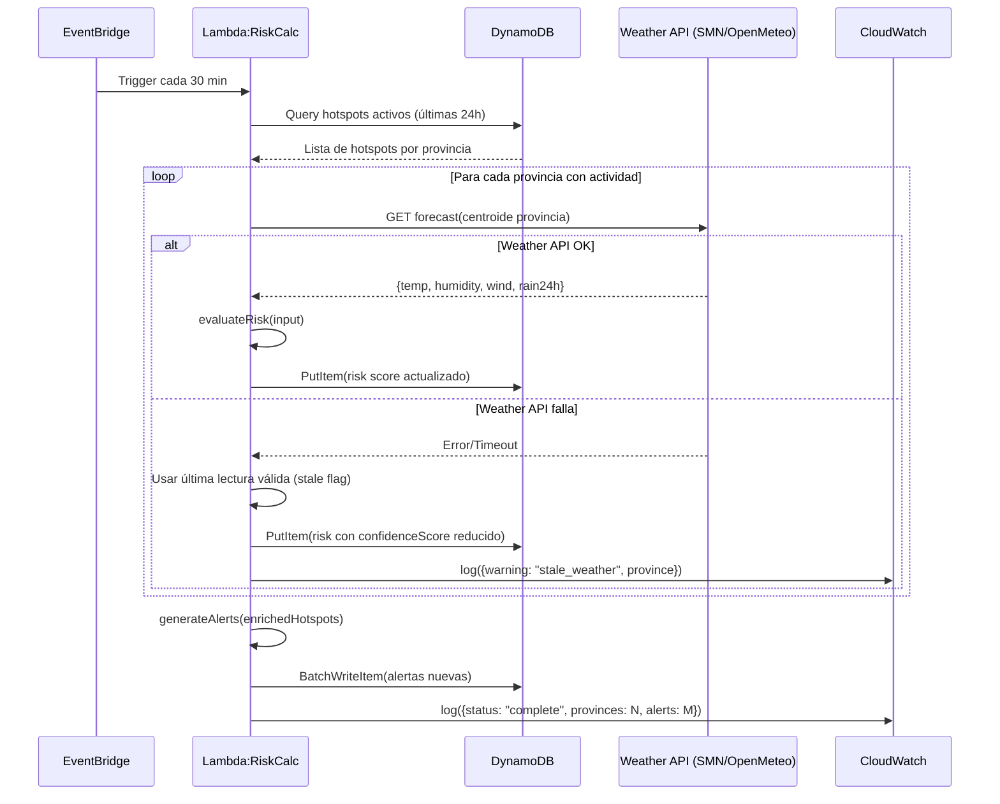
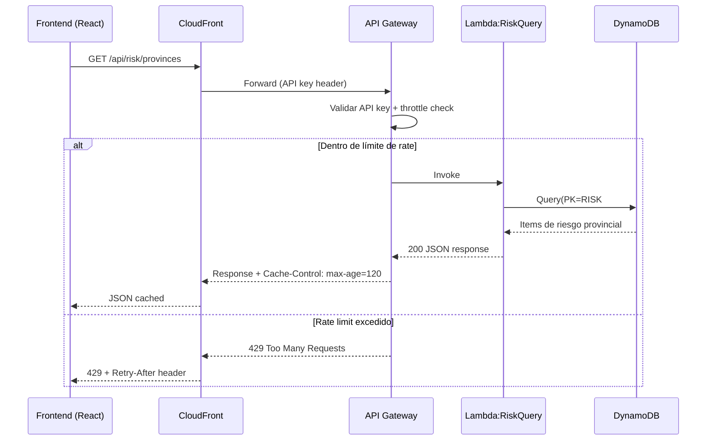

# Documento de Diseño: Fire Risk Engine

## Resumen General

El **Fire Risk Engine** es el motor central de cálculo de riesgo de incendio para "Alerta Fuego Argentina", diseñado como una arquitectura serverless sobre AWS. Su propósito es ingerir datos satelitales de NASA FIRMS, combinarlos con datos meteorológicos del SMN, calcular un índice de peligro de incendio (FWI) por zona y provincia, y generar alertas automáticas para la población.

La arquitectura prioriza: costo mínimo operativo (pay-per-use), mínimos permisos IAM (least privilege), escalabilidad nacional (24 provincias, ~3.500 zonas), diseño óptimo de claves en DynamoDB, logs controlados vía CloudWatch, protección de API con throttling y API keys, y tolerancia a errores de fuentes externas (FIRMS, SMN).

El sistema se compone de tres flujos principales: (1) Ingesta programada de datos FIRMS vía EventBridge → Lambda, (2) Cálculo de riesgo bajo demanda o programado, y (3) Consulta de riesgo por API Gateway → Lambda → DynamoDB con caché en memoria.

## Arquitectura

### Diagrama de Infraestructura AWS



### Diagrama de Secuencia: Ingesta FIRMS



### Diagrama de Secuencia: Cálculo de Riesgo



### Diagrama de Secuencia: Consulta API



## Componentes e Interfaces

### Componente 1: FirmsIngestionLambda

**Propósito**: Ingesta programada de datos satelitales FIRMS, normalización, geocodificación provincial y persistencia en DynamoDB.

**Interface**:
```typescript
interface FirmsIngestionHandler {
  handler(event: EventBridgeEvent): Promise<IngestionResult>;
}

interface IngestionResult {
  statusCode: number;
  body: {
    rawEntries: number;
    savedTo: string;
    geocodedArgentina: number;
    duplicatesRemoved: number;
    finalCount: number;
    timestamp: string;
  };
}

interface EventBridgeEvent {
  source: 'aws.scheduler';
  'detail-type': 'FirmsIngestion';
  detail: {
    forceRefresh?: boolean;
  };
}
```

**Responsabilidades**:
- Consultar NASA FIRMS API con timeout de 6 segundos
- Guardar CSV raw en S3 para auditoría
- Normalizar coordenadas, confianza y timestamps
- Asignar provincia mediante point-in-polygon
- Deduplicar detecciones cercanas (< 0.015° y < 30 min)
- Persistir en DynamoDB con TTL de 48 horas
- Tolerancia a fallas: mantener datos previos si API externa falla

### Componente 2: RiskCalculationLambda

**Propósito**: Calcular índices de riesgo de incendio por provincia y zona, combinando datos meteorológicos con hotspots activos.

**Interface**:
```typescript
interface RiskCalculationHandler {
  handler(event: EventBridgeEvent): Promise<RiskCalcResult>;
}

interface RiskCalcResult {
  statusCode: number;
  body: {
    provincesProcessed: number;
    alertsGenerated: number;
    staleWeatherCount: number;
    timestamp: string;
  };
}

interface RiskInput {
  temperature: number;
  relativeHumidity: number;
  windSpeed: number;
  rain24h: number;
  province: string;
  region: 'Patagonia' | 'Centro' | 'Norte' | 'Cuyo' | 'Litoral';
  recentHotspotsCount: number;
  historicalFireCount: number;
  climateNormal: ClimateNormal;
  hasCriticalAlert?: boolean;
}

interface RiskOutput {
  riskScore: number;       // 0-100
  riskLevel: DangerLevel;  // 'Bajo' | 'Medio' | 'Alto' | 'Muy Alto' | 'Extremo'
  explanation: string;
  confidenceScore: number; // 0-100
}

type DangerLevel = 'Bajo' | 'Medio' | 'Alto' | 'Muy Alto' | 'Extremo';
```

**Responsabilidades**:
- Leer hotspots activos de DynamoDB (últimas 24h)
- Consultar API meteorológica para cada provincia activa
- Calcular FWI (Fire Weather Index) compuesto
- Evaluar riesgo integral con 8 factores ponderados
- Generar alertas automáticas si umbral superado
- Marcar datos como "stale" si fuente meteorológica falla

### Componente 3: API Query Lambdas

**Propósito**: Servir consultas del frontend con baja latencia desde DynamoDB.

**Interface**:
```typescript
interface APIGatewayHandler {
  handler(event: APIGatewayProxyEvent): Promise<APIGatewayProxyResult>;
}

// Endpoints disponibles
interface RiskAPI {
  'GET /risk/provinces': () => ProvinceRisk[];
  'GET /risk/zones': () => GridCell[];
  'GET /hotspots': () => EnrichedHotspot[];
  'GET /alerts': () => Alert[];
  'POST /subscriptions': (body: SubscriptionRequest) => SubscriptionResult;
  'GET /health': () => HealthStatus;
}

interface ProvinceRisk {
  provinceName: string;
  riskScore: number;
  activeHotspotsCount: number;
  riskLevel: DangerLevel;
  trend: 'up' | 'down' | 'stable';
  lastUpdated: string;
  confidenceScore: number;
}

interface GridCell {
  id: string;
  bounds: [[number, number], [number, number]];
  fwi: number;
  riskLevel: DangerLevel;
  hotspotsInCell: number;
}
```

**Responsabilidades**:
- Leer datos pre-calculados de DynamoDB (sin cálculo en tiempo real)
- Aplicar caché de API Gateway (TTL 120s para risk, 60s para hotspots)
- Validar API key en cada request
- Retornar 429 si throttle excedido

### Componente 4: NotificationDispatcher

**Propósito**: Enviar notificaciones a usuarios suscritos cuando se generan alertas críticas.

**Interface**:
```typescript
interface NotificationHandler {
  handler(event: SNSEvent): Promise<void>;
}

interface SubscriptionRequest {
  email: string;
  provinces: string[];
  minSeverity: 'Bajo' | 'Medio' | 'Alto' | 'Crítico';
}

interface SubscriptionResult {
  subscriptionId: string;
  status: 'active' | 'pending_verification';
}
```

**Responsabilidades**:
- Recibir eventos de SNS con alertas nuevas
- Consultar suscripciones activas en DynamoDB
- Filtrar por provincia y severidad mínima
- Enviar emails vía SES
- Registrar entregas en CloudWatch

## Modelos de Datos

### Diseño de Tabla Única DynamoDB (Single Table Design)

```typescript
// Diseño de clave compuesta para Single Table Design
interface DynamoDBKeyDesign {
  PK: string;  // Partition Key
  SK: string;  // Sort Key
  GSI1PK?: string;  // Global Secondary Index 1 - Partition
  GSI1SK?: string;  // Global Secondary Index 1 - Sort
  GSI2PK?: string;  // Global Secondary Index 2 - Partition
  GSI2SK?: string;  // Global Secondary Index 2 - Sort
  TTL?: number;     // Unix timestamp para expiración automática
}

// === ENTIDAD: Hotspot ===
interface HotspotItem extends DynamoDBKeyDesign {
  PK: `HOTSPOT#${string}`;           // HOTSPOT#{province}
  SK: `TS#${string}#${string}`;      // TS#{isoDate}#{hotspotId}
  GSI1PK: `DATE#${string}`;          // DATE#{yyyy-mm-dd}
  GSI1SK: `PROV#${string}`;          // PROV#{province}
  lat: number;
  lng: number;
  brightness: number;
  confidence: number;
  satellite: 'VIIRS' | 'MODIS';
  province: string;
  TTL: number;  // now + 48h
}

// === ENTIDAD: Risk Score (Provincial) ===
interface RiskScoreItem extends DynamoDBKeyDesign {
  PK: 'RISK#CURRENT';
  SK: `PROVINCE#${string}`;           // PROVINCE#{provinceName}
  GSI1PK: `RISKLEVEL#${string}`;      // RISKLEVEL#{dangerLevel}
  GSI1SK: `SCORE#${string}`;          // SCORE#{paddedScore}
  riskScore: number;
  riskLevel: DangerLevel;
  activeHotspotsCount: number;
  trend: 'up' | 'down' | 'stable';
  explanation: string;
  confidenceScore: number;
  lastUpdated: string;
  weatherStale: boolean;
}

// === ENTIDAD: Risk Score (Zona/Grid) ===
interface RiskZoneItem extends DynamoDBKeyDesign {
  PK: 'RISK#ZONES';
  SK: `GRID#${string}`;               // GRID#{latFloor}#{lngFloor}
  GSI1PK: `PROVINCE#${string}`;
  GSI1SK: `FWI#${string}`;            // FWI#{paddedFwi}
  bounds: [[number, number], [number, number]];
  fwi: number;
  riskLevel: DangerLevel;
  hotspotsInCell: number;
  lastUpdated: string;
}

// === ENTIDAD: Alerta ===
interface AlertItem extends DynamoDBKeyDesign {
  PK: `ALERT#${string}`;              // ALERT#{province}
  SK: `TS#${string}#${string}`;       // TS#{isoDate}#{alertId}
  GSI1PK: `SEVERITY#${string}`;       // SEVERITY#{level}
  GSI1SK: `TS#${string}`;
  title: string;
  description: string;
  severity: 'Bajo' | 'Medio' | 'Alto' | 'Crítico';
  type: 'Incendio' | 'Meteorológica' | 'Evacuación' | 'Prevención';
  locationName: string;
  coordinates: { lat: number; lng: number };
  radius: number;
  TTL: number;  // now + 7 días
}

// === ENTIDAD: Suscripción ===
interface SubscriptionItem extends DynamoDBKeyDesign {
  PK: `SUB#${string}`;                // SUB#{email}
  SK: `PROV#${string}`;               // PROV#{province}
  GSI1PK: `PROVINCE#${string}`;       // Para buscar suscriptores por provincia
  GSI1SK: `SEVERITY#${string}`;
  email: string;
  minSeverity: 'Bajo' | 'Medio' | 'Alto' | 'Crítico';
  verified: boolean;
  createdAt: string;
}

// === ENTIDAD: Metadata de Ingesta ===
interface IngestionMetaItem extends DynamoDBKeyDesign {
  PK: 'META#INGESTION';
  SK: `RUN#${string}`;                // RUN#{timestamp}
  rawEntries: number;
  finalCount: number;
  duplicatesRemoved: number;
  source: 'FIRMS_API' | 'FALLBACK_CACHE';
  duration_ms: number;
  TTL: number;  // now + 30 días
}
```

**Patrones de Acceso (Access Patterns)**:

| # | Patrón | Operación | Clave |
|---|--------|-----------|-------|
| 1 | Hotspots por provincia (últimas 24h) | Query | PK=`HOTSPOT#{prov}`, SK begins_with `TS#{today}` |
| 2 | Todos los hotspots de hoy | Query GSI1 | GSI1PK=`DATE#{today}` |
| 3 | Risk score actual por provincia | GetItem | PK=`RISK#CURRENT`, SK=`PROVINCE#{prov}` |
| 4 | Todas las provincias ordenadas por riesgo | Query GSI1 | GSI1PK=`RISKLEVEL#{level}` |
| 5 | Alertas activas por provincia | Query | PK=`ALERT#{prov}`, SK begins_with `TS#` |
| 6 | Alertas por severidad | Query GSI1 | GSI1PK=`SEVERITY#{level}` |
| 7 | Suscripciones por provincia | Query GSI1 | GSI1PK=`PROVINCE#{prov}` |
| 8 | Historial de ingestas | Query | PK=`META#INGESTION`, SK begins_with `RUN#` |
| 9 | Zonas de riesgo por provincia | Query GSI1 | GSI1PK=`PROVINCE#{prov}` |

**Índices Secundarios Globales (GSI)**:

| GSI | Partition Key | Sort Key | Proyección | Propósito |
|-----|--------------|----------|------------|-----------|
| GSI1 | GSI1PK | GSI1SK | ALL | Consultas temporales, por severidad, por nivel de riesgo |
| GSI2 | GSI2PK | GSI2SK | KEYS_ONLY | Reservado para futuros patrones de acceso |

**Reglas de Validación**:
- `riskScore` debe estar en rango [0, 100]
- `confidenceScore` debe estar en rango [50, 100]
- `TTL` debe ser timestamp futuro
- `province` debe ser una de las 23 provincias + CABA
- `coordinates.lat` debe estar en rango [-56.0, -21.8]
- `coordinates.lng` debe estar en rango [-73.6, -53.5]

## Pseudocódigo Algorítmico con Especificaciones Formales

### Algoritmo Principal: Evaluación de Riesgo de Incendio

```typescript
/**
 * ALGORITMO: evaluateFireRisk
 * 
 * Calcula un score compuesto de riesgo de incendio integrando 8 factores
 * ponderados: temperatura, humedad, viento, precipitación, hotspots activos,
 * historial, alertas críticas y factores regionales.
 */
function evaluateFireRisk(input: RiskInput): RiskOutput {
  // PRECONDICIONES:
  // - input.temperature ∈ [-20, 50] (rango físico posible en Argentina)
  // - input.relativeHumidity ∈ [0, 100]
  // - input.windSpeed ≥ 0
  // - input.rain24h ≥ 0
  // - input.recentHotspotsCount ≥ 0
  // - input.region ∈ {'Patagonia', 'Centro', 'Norte', 'Cuyo', 'Litoral'}

  let score = 25; // baseline promedio

  // Factor 1: Temperatura (peso: hasta ±20 puntos)
  if (input.temperature > 32) score += 20;
  else if (input.temperature > 24) score += 10;
  else if (input.temperature < 15) score -= 10;

  // Factor 2: Humedad Relativa (peso: hasta ±30 puntos) — MAYOR PESO
  if (input.relativeHumidity < 15) score += 30;
  else if (input.relativeHumidity < 30) score += 15;
  else if (input.relativeHumidity > 60) score -= 15;

  // Factor 3: Viento (peso: hasta +20 puntos)
  if (input.windSpeed > 30) score += 20;
  else if (input.windSpeed > 18) score += 10;

  // Factor 4: Precipitación - Supresor (peso: hasta -30 puntos)
  if (input.rain24h > 10) score -= 30;
  else if (input.rain24h > 2) score -= 15;

  // Factor 5: Hotspots Activos (peso: hasta +25 puntos)
  score += Math.min(25, input.recentHotspotsCount * 8);

  // Factor 6: Historial (peso: hasta +10 puntos)
  score += Math.min(10, input.historicalFireCount * 0.5);

  // Factor 7: Alerta Crítica Activa (peso: +15 puntos)
  if (input.hasCriticalAlert) score += 15;

  // Factor 8: Factores Regionales (peso: +5 puntos)
  if (input.region === 'Centro' && input.relativeHumidity < 20) score += 5;
  if (input.region === 'Patagonia' && input.windSpeed > 25) score += 5;

  const finalScore = Math.min(100, Math.max(0, Math.round(score)));
  const riskLevel = getDangerLevel(finalScore);
  const confidenceScore = calculateConfidence(input);

  return { riskScore: finalScore, riskLevel, explanation: '', confidenceScore };

  // POSTCONDICIONES:
  // - result.riskScore ∈ [0, 100]
  // - result.riskLevel = getDangerLevel(result.riskScore)
  // - result.confidenceScore ∈ [50, 100]
  // - Si rain24h > 10 → result.riskScore ≤ 70 (precipitación siempre suprime)
  // - Si recentHotspotsCount > 3 → result.riskScore ≥ 25 (hotspots garantizan mínimo)
}
```

**Precondiciones:**
- `input` es un objeto válido con todos los campos requeridos
- `input.temperature` está en el rango [-20, 50] °C
- `input.relativeHumidity` está en [0, 100] %
- `input.windSpeed` es no-negativo (km/h)
- `input.rain24h` es no-negativo (mm)
- `input.region` es uno de los 5 valores válidos del enum

**Postcondiciones:**
- El `riskScore` resultante está clampeado a [0, 100]
- El `riskLevel` corresponde biyectivamente al score según rangos definidos
- El `confidenceScore` nunca baja de 50 (mínimo operacional)
- Lluvias > 10mm siempre reducen el score en al menos 30 puntos desde baseline
- Hotspots activos siempre contribuyen positivamente al score

**Invariantes de Loop:** N/A (algoritmo secuencial sin loops sobre el input)

---

### Algoritmo: Cálculo de FWI Simplificado

```typescript
/**
 * ALGORITMO: calculateFWI
 * 
 * Calcula Fire Weather Index simplificado como combinación lineal
 * ponderada de factores meteorológicos normalizados.
 */
function calculateFWI(weather: WeatherData): number {
  // PRECONDICIONES:
  // - weather.temperature ∈ [-20, 50]
  // - weather.relativeHumidity ∈ [0, 100]
  // - weather.windSpeed ≥ 0

  const tempFactor = weather.temperature * 1.0;           // Contribución directa
  const humidityFactor = (100 - weather.relativeHumidity) * 0.5;  // Inversa: menos humedad = más riesgo
  const windFactor = weather.windSpeed * 0.4;             // Contribución proporcional

  const rawFWI = tempFactor + humidityFactor + windFactor;
  return Math.min(100, Math.max(0, Math.round(rawFWI)));

  // POSTCONDICIONES:
  // - resultado ∈ [0, 100]
  // - monotónicamente creciente respecto a temperature
  // - monotónicamente decreciente respecto a relativeHumidity
  // - monotónicamente creciente respecto a windSpeed
}
```

**Precondiciones:**
- `weather` contiene datos meteorológicos válidos
- Todos los campos numéricos están en sus rangos físicos

**Postcondiciones:**
- El FWI resultante está en [0, 100]
- Es monótono creciente en temperatura y viento
- Es monótono decreciente en humedad

**Invariantes de Loop:** N/A

---

### Algoritmo: Deduplicación de Hotspots

```typescript
/**
 * ALGORITMO: detectDuplicates
 * 
 * Filtra detecciones duplicadas del mismo foco ígneo usando
 * proximidad espacial (< 0.015°) y temporal (< 30 min).
 * Retiene la detección de mayor confianza/brillo.
 */
function detectDuplicates(hotspots: RawHotspot[]): RawHotspot[] {
  // PRECONDICIONES:
  // - hotspots es un array no-nulo
  // - cada hotspot tiene lat, lng, date, confidence, brightness válidos

  const clean: RawHotspot[] = [];

  for (const h of hotspots) {
    // INVARIANTE: clean no contiene duplicados entre sí
    // INVARIANTE: |clean| ≤ índice actual del iterador
    
    let isDuplicate = false;

    for (const existing of clean) {
      const spatialDist = Math.sqrt(
        Math.pow(h.lat - existing.lat, 2) + Math.pow(h.lng - existing.lng, 2)
      );
      const temporalDist = Math.abs(
        new Date(h.date).getTime() - new Date(existing.date).getTime()
      );

      if (spatialDist <= 0.015 && temporalDist <= 30 * 60 * 1000 && h.satellite === existing.satellite) {
        isDuplicate = true;
        // Merge: retener mayor confianza/brillo
        if (h.confidence > existing.confidence ||
            (h.confidence === existing.confidence && h.brightness > existing.brightness)) {
          existing.brightness = h.brightness;
          existing.confidence = h.confidence;
          existing.date = h.date;
        }
        break;
      }
    }

    if (!isDuplicate) {
      clean.push(h);
    }
  }

  return clean;

  // POSTCONDICIONES:
  // - |resultado| ≤ |hotspots|
  // - No existen dos elementos en resultado con dist < 0.015° Y tdiff < 30min Y mismo satélite
  // - Para cada par de duplicados, se retiene el de mayor confidence
  // - Todos los elementos del resultado estaban en el input original
}
```

**Precondiciones:**
- `hotspots` es un array válido (puede estar vacío)
- Cada elemento tiene coordenadas y timestamps parseables

**Postcondiciones:**
- El resultado es un subconjunto del input
- No existen duplicados espaciotemporales en el resultado
- Se preserva la detección de mayor calidad en caso de merge

**Invariantes de Loop:**
- `clean` nunca contiene pares duplicados entre sí
- El tamaño de `clean` es ≤ al número de iteraciones completadas

---

### Algoritmo: Asignación de Provincia (Point-in-Polygon)

```typescript
/**
 * ALGORITMO: assignProvince
 * 
 * Geocodificación inversa: dado un punto (lng, lat), determina
 * la provincia argentina que lo contiene usando ray-casting.
 */
function assignProvince(lng: number, lat: number): string {
  // PRECONDICIONES:
  // - lng ∈ [-73.6, -53.5] (longitud Argentina)
  // - lat ∈ [-56.0, -21.8] (latitud Argentina)
  // - GeoJSON de provincias cargado en memoria

  const geojson = loadProvincesGeoJson();

  for (const feature of geojson.features) {
    if (isPointInGeometry(lng, lat, feature.geometry)) {
      return feature.properties.nombre;
    }
  }

  return 'Fuera de Argentina';

  // POSTCONDICIONES:
  // - resultado es nombre de provincia válido OR 'Fuera de Argentina'
  // - Si punto está dentro de polygon de provincia X → retorna X
  // - Si punto no está en ningún polygon → retorna 'Fuera de Argentina'
  // - Función es determinista: mismas coordenadas → mismo resultado
}
```

**Precondiciones:**
- Las coordenadas están en el bbox de Argentina
- El GeoJSON de provincias está disponible y es válido

**Postcondiciones:**
- Retorna exactamente un nombre de provincia o el valor centinela
- Es determinista y sin efectos secundarios

**Invariantes de Loop:**
- Si el loop no ha retornado, el punto no pertenece a ninguna provincia iterada hasta ahora

## Funciones Clave con Especificaciones Formales

### calculateConfidence()

```typescript
function calculateConfidence(input: RiskInput): number
```

**Precondiciones:**
- `input` contiene `climateNormal` con valores históricos válidos
- `input.temperature`, `input.windSpeed`, `input.relativeHumidity` están en rangos físicos

**Postcondiciones:**
- Retorna valor en [50, 100]
- Comienza en 95 y se reduce por desviaciones extremas del clima normal
- Reduce 5 puntos por cada desviación extrema (temp > 15°, wind > 25 km/h, humidity > 40%)
- Reduce 3 puntos si no hay hotspots recientes que validen la zona
- Nunca baja de 50

**Invariantes de Loop:** N/A

---

### getDangerLevel()

```typescript
function getDangerLevel(fwi: number): DangerLevel
```

**Precondiciones:**
- `fwi` ∈ [0, 100]

**Postcondiciones:**
- fwi < 20 → 'Bajo'
- 20 ≤ fwi < 40 → 'Medio'
- 40 ≤ fwi < 60 → 'Alto'
- 60 ≤ fwi < 80 → 'Muy Alto'
- fwi ≥ 80 → 'Extremo'
- Función es total: todo valor en [0,100] tiene un resultado definido
- Es monótonamente creciente en severidad

---

### estimateFireArea()

```typescript
function estimateFireArea(brightness: number, windSpeed: number, fwi: number): number
```

**Precondiciones:**
- `brightness` > 0 (en Kelvin, típicamente 300-400K para VIIRS)
- `windSpeed` ≥ 0
- `fwi` ∈ [0, 100]

**Postcondiciones:**
- Retorna área estimada en hectáreas, mínimo 1
- Fórmula: max(1, round((brightness - 300) * 2.2 + windSpeed * 1.8 + fwi * 0.8))
- Monotónicamente creciente en los tres parámetros
- Si brightness ≤ 300 → contribución térmica es 0

## Ejemplo de Uso

```typescript
// Ejemplo 1: Evaluación de riesgo para Córdoba en temporada seca
const cordobaInput: RiskInput = {
  temperature: 35,
  relativeHumidity: 12,
  windSpeed: 28,
  rain24h: 0,
  province: 'Córdoba',
  region: 'Centro',
  recentHotspotsCount: 4,
  historicalFireCount: 15,
  climateNormal: { avgTemp: 22, avgHumidity: 45, avgWind: 12 },
  hasCriticalAlert: true
};

const result = evaluateFireRisk(cordobaInput);
// Esperado: riskScore ~ 92-100, riskLevel = 'Extremo'

// Ejemplo 2: Provincia sin actividad con lluvias recientes
const entreRiosInput: RiskInput = {
  temperature: 18,
  relativeHumidity: 72,
  windSpeed: 8,
  rain24h: 15,
  province: 'Entre Ríos',
  region: 'Litoral',
  recentHotspotsCount: 0,
  historicalFireCount: 3,
  climateNormal: { avgTemp: 20, avgHumidity: 65, avgWind: 10 },
  hasCriticalAlert: false
};

const result2 = evaluateFireRisk(entreRiosInput);
// Esperado: riskScore ~ 0-15, riskLevel = 'Bajo'

// Ejemplo 3: Consulta DynamoDB de riesgo provincial
const params = {
  TableName: 'FireRiskEngine',
  KeyConditionExpression: 'PK = :pk',
  ExpressionAttributeValues: { ':pk': 'RISK#CURRENT' }
};
const { Items } = await dynamodb.query(params);
// Retorna 24 items (uno por provincia) con risk scores actualizados

// Ejemplo 4: Ingesta con fallback
const ingestionResult = await firmsIngestion.runIngestionPipeline();
// Si FIRMS API falla: usa caché local, marca source='FALLBACK_CACHE'
// Si OK: persiste en DDB con TTL de 48h
```

## Propiedades de Correctitud

*Una propiedad es una característica o comportamiento que debe mantenerse verdadero en todas las ejecuciones válidas de un sistema — esencialmente, una declaración formal sobre lo que el sistema debe hacer. Las propiedades sirven como puente entre especificaciones legibles por humanos y garantías de correctitud verificables por máquina.*

### Propiedad 1: Acotamiento del riskScore

*Para cualquier* input válido de RiskInput (con temperatura ∈ [-20, 50], humedad ∈ [0, 100], viento ≥ 0, precipitación ≥ 0 y demás factores dentro de sus rangos), el riskScore retornado por evaluateFireRisk SHALL estar en el rango [0, 100].

**Valida: Requisito 3.3**

### Propiedad 2: Consistencia nivel-score

*Para cualquier* resultado de evaluateFireRisk, el riskLevel asignado SHALL corresponder exactamente al resultado de aplicar getDangerLevel(riskScore) según los umbrales definidos (< 20 → Bajo, 20-39 → Medio, 40-59 → Alto, 60-79 → Muy Alto, ≥ 80 → Extremo).

**Valida: Requisito 3.4**

### Propiedad 3: Monotonía del FWI

*Para cualesquiera* dos conjuntos de datos meteorológicos que difieren en exactamente un parámetro: (a) si la temperatura es mayor, el FWI SHALL ser mayor o igual; (b) si la humedad es mayor, el FWI SHALL ser menor o igual; (c) si el viento es mayor, el FWI SHALL ser mayor o igual.

**Valida: Requisitos 4.2, 4.3, 4.4**

### Propiedad 4: Supresión por lluvia

*Para cualquier* RiskInput con rain24h > 10mm, el riskScore resultante SHALL ser al menos 30 puntos menor que el score calculado con los mismos parámetros pero rain24h = 0.

**Valida: Requisito 3.5**

### Propiedad 5: Invariante de no-duplicados en resultado

*Para cualesquiera* dos hotspots h1, h2 en el resultado de detectDuplicates(input), al menos una de las siguientes condiciones SHALL cumplirse: dist(h1, h2) > 0.015° OR timeDiff(h1, h2) > 30 minutos OR h1.satellite ≠ h2.satellite.

**Valida: Requisito 7.4**

### Propiedad 6: Cota mínima del Score de Confianza

*Para cualquier* input válido de RiskInput (incluyendo desviaciones extremas del clima normal), calculateConfidence SHALL retornar un valor ≥ 50 y ≤ 100.

**Valida: Requisito 5.6**

### Propiedad 7: Determinismo de geocodificación

*Para cualesquiera* coordenadas (lng, lat) dentro del bounding box de Argentina, assignProvince(lng, lat) invocado múltiples veces SHALL retornar siempre el mismo resultado.

**Valida: Requisito 8.2**

### Propiedad 8: Conservación en deduplicación

*Para cualquier* lista de hotspots (vacía o no), el tamaño de detectDuplicates(hotspots) SHALL ser menor o igual al tamaño de la lista original.

**Valida: Requisito 7.3**

### Propiedad 9: Cota mínima del área estimada y monotonía

*Para cualquier* combinación válida de brightness (> 0), windSpeed (≥ 0) y fwi (∈ [0, 100]), estimateFireArea SHALL retornar un valor ≥ 1 hectárea, y SHALL ser monotónicamente creciente respecto a cada uno de los tres parámetros individualmente.

**Valida: Requisitos 12.2, 12.4**

### Propiedad 10: Normalización preserva campos requeridos

*Para cualquier* fila CSV válida de FIRMS con los headers esperados, la normalización SHALL producir un objeto con todos los campos requeridos: id (no vacío), lat (numérico), lng (numérico), brightness (numérico > 0), confidence (∈ [0, 100]), date (ISO válido) y satellite ('VIIRS' o 'MODIS').

**Valida: Requisito 1.3**

### Propiedad 11: Filtrado de notificaciones por criterio

*Para cualquier* combinación de alerta y lista de suscripciones, el Despachador_de_Notificaciones SHALL enviar notificación únicamente a suscriptores cuya provincia coincide con la de la alerta Y cuya severidad mínima configurada es ≤ a la severidad de la alerta.

**Valida: Requisitos 10.2, 10.3**

### Propiedad 12: Acotamiento del FWI

*Para cualquier* input meteorológico válido (temperatura ∈ [-20, 50], humedad ∈ [0, 100], viento ≥ 0), calculateFWI SHALL producir un resultado en el rango [0, 100].

**Valida: Requisito 4.1**

### Propiedad 13: Contribución de hotspots activos

*Para cualquier* RiskInput con recentHotspotsCount > 0, el riskScore SHALL ser al menos min(25, recentHotspotsCount × 8) puntos mayor que el score calculado con recentHotspotsCount = 0 y todos los demás inputs iguales.

**Valida: Requisito 3.6**

## Manejo de Errores

### Escenario 1: Falla de NASA FIRMS API

**Condición**: API retorna error HTTP, timeout (> 6s), o datos corruptos
**Respuesta**: Lambda registra warning en CloudWatch, usa último CSV raw almacenado en S3 como fallback
**Recuperación**: Próxima ejecución programada (15 min) reintenta. Si falla 3 veces consecutivas → alarm en CloudWatch → notificación SNS a operadores

### Escenario 2: Falla de API Meteorológica

**Condición**: SMN/OpenMeteo no responde o retorna datos fuera de rango
**Respuesta**: Usa última lectura válida almacenada en DynamoDB, marca `weatherStale: true`, reduce `confidenceScore` en 10 puntos
**Recuperación**: Próximo ciclo de cálculo (30 min) reintenta. El frontend muestra indicador visual de "datos parcialmente desactualizados"

### Escenario 3: DynamoDB Throttling

**Condición**: Capacidad de escritura/lectura excedida (modo on-demand raro, pero posible en burst extremo)
**Respuesta**: SDK de AWS aplica retry exponencial automático (hasta 3 reintentos)
**Recuperación**: Si persiste, CloudWatch alarm notifica. Considerar switch temporario a modo provisioned con auto-scaling

### Escenario 4: Coordenadas fuera del bbox de Argentina

**Condición**: FIRMS retorna puntos en países limítrofes (Chile, Brasil, Uruguay)
**Respuesta**: `assignProvince()` retorna 'Fuera de Argentina', punto se filtra del dataset final
**Recuperación**: Automática, no requiere intervención. Se loguea cantidad filtrada para monitoreo

### Escenario 5: Rate Limiting en API Gateway

**Condición**: Cliente excede el throttle configurado (100 req/s burst, 50 req/s sustained)
**Respuesta**: API Gateway retorna 429 con header `Retry-After`
**Recuperación**: Frontend implementa exponential backoff. CloudFront cache mitiga la mayoría de requests repetidos

## Estrategia de Testing

### Testing Unitario

- Cada función del RiskEngine se testea con inputs extremos y boundary values
- Mock de APIs externas (FIRMS, Weather) para testear flujos de error
- Validar que `evaluateFireRisk` nunca retorna fuera de [0, 100]
- Validar mapeo exhaustivo de `getDangerLevel` para cada rango
- Test de `detectDuplicates` con conjuntos donde todos son duplicados, ninguno es duplicado, y mezcla

### Testing de Propiedades (Property-Based Testing)

**Librería**: fast-check

```typescript
import fc from 'fast-check';

// Propiedad: riskScore siempre en [0, 100]
fc.assert(
  fc.property(
    fc.record({
      temperature: fc.float({ min: -20, max: 50 }),
      relativeHumidity: fc.float({ min: 0, max: 100 }),
      windSpeed: fc.float({ min: 0, max: 80 }),
      rain24h: fc.float({ min: 0, max: 200 }),
      recentHotspotsCount: fc.nat({ max: 50 }),
      // ... otros campos
    }),
    (input) => {
      const result = evaluateFireRisk(input as RiskInput);
      return result.riskScore >= 0 && result.riskScore <= 100;
    }
  )
);

// Propiedad: deduplicación reduce o mantiene tamaño
fc.assert(
  fc.property(
    fc.array(arbitraryHotspot()),
    (hotspots) => detectDuplicates(hotspots).length <= hotspots.length
  )
);

// Propiedad: FWI monótono en temperatura
fc.assert(
  fc.property(
    fc.float({ min: -20, max: 49 }),
    fc.float({ min: 0, max: 100 }),
    fc.float({ min: 0, max: 80 }),
    (temp, humidity, wind) => {
      const w1 = { temperature: temp, relativeHumidity: humidity, windSpeed: wind, windDir: 'N' };
      const w2 = { ...w1, temperature: temp + 1 };
      return calculateFWI(w2) >= calculateFWI(w1);
    }
  )
);
```

### Testing de Integración

- End-to-end del pipeline de ingesta: EventBridge trigger → Lambda → DynamoDB write
- Validar que API Gateway retorna datos consistentes con lo almacenado en DDB
- Test de concurrencia: dos Lambdas de cálculo no corrompen datos al escribir simultáneamente
- Test de TTL: verificar que items expirados no aparecen en queries

## Consideraciones de Rendimiento

| Recurso | Configuración | Justificación |
|---------|--------------|---------------|
| Lambda Memory | 256 MB (Ingesta), 128 MB (Query) | Ingesta procesa CSV; Query solo lee DDB |
| Lambda Timeout | 30s (Ingesta), 10s (Query) | FIRMS API puede tardar hasta 6s |
| DynamoDB Mode | On-Demand | Carga impredecible, evita sobreaprovisionamiento |
| API Gateway Cache | 120s para /risk, 60s para /hotspots | Datos se actualizan cada 15-30 min |
| CloudFront TTL | 300s para assets, 60s para API | Balance entre frescura y costo |
| EventBridge Rate | Ingesta: rate(15 min), Cálculo: rate(30 min) | Ventana FIRMS es ~10min; cálculo más costoso |

**Estimación de Costo Mensual (Free Tier agotado)**:
- Lambda: ~$0.50 (ingesta 4/h * 720h + cálculo 2/h * 720h + queries ~5000/día)
- DynamoDB On-Demand: ~$1.00 (escrituras ~100K/mes, lecturas ~500K/mes)
- S3: ~$0.05 (raw CSVs ~50MB/mes)
- API Gateway: ~$3.50 (1M requests/mes)
- CloudWatch: ~$0.50 (logs con retención 7 días)
- **Total estimado: ~$6-8 USD/mes**

## Consideraciones de Seguridad

### Permisos IAM (Least Privilege)

```typescript
// Lambda: FirmsIngestion
const ingestionPolicy = {
  actions: [
    'dynamodb:BatchWriteItem',
    'dynamodb:PutItem',
    's3:PutObject',
    'logs:CreateLogGroup',
    'logs:CreateLogStream',
    'logs:PutLogEvents'
  ],
  resources: [
    'arn:aws:dynamodb:*:*:table/FireRiskEngine',
    'arn:aws:s3:::fuegoradar-raw/*',
    'arn:aws:logs:*:*:log-group:/aws/lambda/firms-ingestion:*'
  ]
};

// Lambda: RiskQuery (solo lectura)
const queryPolicy = {
  actions: [
    'dynamodb:Query',
    'dynamodb:GetItem',
    'logs:CreateLogGroup',
    'logs:CreateLogStream',
    'logs:PutLogEvents'
  ],
  resources: [
    'arn:aws:dynamodb:*:*:table/FireRiskEngine',
    'arn:aws:dynamodb:*:*:table/FireRiskEngine/index/*',
    'arn:aws:logs:*:*:log-group:/aws/lambda/risk-query:*'
  ]
};

// Lambda: RiskCalculation
const calcPolicy = {
  actions: [
    'dynamodb:Query',
    'dynamodb:PutItem',
    'dynamodb:BatchWriteItem',
    'sns:Publish',
    'logs:CreateLogGroup',
    'logs:CreateLogStream',
    'logs:PutLogEvents'
  ],
  resources: [
    'arn:aws:dynamodb:*:*:table/FireRiskEngine',
    'arn:aws:dynamodb:*:*:table/FireRiskEngine/index/*',
    'arn:aws:sns:*:*:fire-risk-alerts',
    'arn:aws:logs:*:*:log-group:/aws/lambda/risk-calculation:*'
  ]
};
```

### Protección de API

- **API Keys**: Requeridas en header `x-api-key` para todo request
- **Usage Plans**: Throttle 50 req/s sustained, 100 req/s burst por API key
- **WAF**: Reglas básicas para bloquear IPs con comportamiento abusivo
- **CORS**: Restringido al dominio del frontend (no wildcard `*` en producción)
- **Validación de Input**: Todos los endpoints validan parámetros antes de consultar DDB

### Logs Controlados

- Retención: 7 días en CloudWatch (suficiente para debugging, minimiza costo)
- Nivel: INFO para operaciones normales, WARN para fallbacks, ERROR para fallas
- **NO loguear**: API keys, emails de suscriptores, datos personales
- Alarmas: Error rate > 5% en ventana de 5 min → notificación SNS

## Dependencias

| Dependencia | Tipo | Propósito |
|-------------|------|-----------|
| AWS Lambda | Servicio | Compute serverless |
| AWS DynamoDB | Servicio | Base de datos principal |
| AWS API Gateway | Servicio | Endpoint HTTP con throttling |
| AWS EventBridge | Servicio | Scheduler para ingesta/cálculo |
| AWS S3 | Servicio | Almacenamiento raw CSVs y frontend |
| AWS CloudFront | Servicio | CDN para frontend y caché API |
| AWS CloudWatch | Servicio | Logs y alarmas |
| AWS SNS/SES | Servicio | Notificaciones (opcional) |
| NASA FIRMS API | Externa | Fuente de datos satelitales |
| SMN / OpenMeteo | Externa | Datos meteorológicos |
| @aws-sdk/client-dynamodb | NPM | SDK DynamoDB v3 |
| @aws-sdk/client-s3 | NPM | SDK S3 v3 |
| fast-check | NPM (dev) | Property-based testing |

## Riesgos Identificados

| # | Riesgo | Probabilidad | Impacto | Mitigación |
|---|--------|-------------|---------|-----------|
| 1 | FIRMS API cambia formato CSV | Media | Alto | Validar headers en normalización; alertar si schema difiere |
| 2 | Costo DynamoDB en picos de actividad (incendios masivos) | Baja | Medio | On-Demand absorbe picos; alarma si WCU > umbral |
| 3 | Cold start de Lambdas afecta latencia API | Media | Bajo | Provisioned concurrency para query Lambda si necesario |
| 4 | Datos meteorológicos stale producen falsos negativos | Media | Alto | Flag visual en UI; reduce confidence; alarma tras 3h stale |
| 5 | Hotspot fuera de polygon por imprecisión GeoJSON | Baja | Bajo | Buffer de 0.01° en bordes interprovinciales |
| 6 | Rate limit de FIRMS API (100 req/min) | Baja | Medio | Una sola request cada 15 min; no excede límite |
